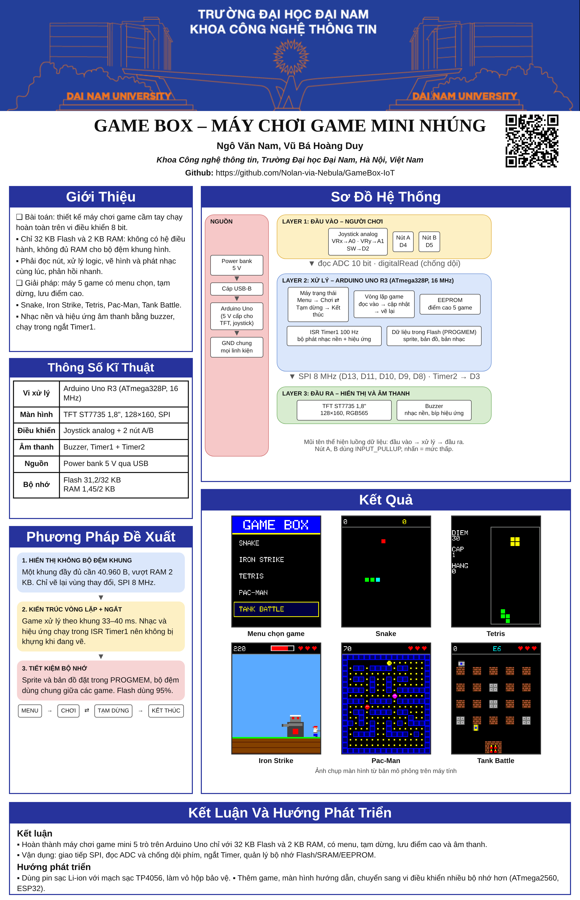

# GAME-BOX

Dự án **máy chơi game mini nhúng** chạy hoàn toàn trên vi điều khiển ATmega328P (Arduino Uno R3), với 5 trò chơi, menu chọn game, tạm dừng, lưu điểm cao và âm thanh bằng buzzer.

## Tổng quan
Hệ thống gồm ba tầng:
- **Đầu vào:** Joystick analog (A0, A1, SW) và 2 nút A/B (D4, D5, INPUT_PULLUP, chống dội bằng phần mềm).
- **Xử lý:** Arduino Uno R3 (16 MHz, 32 KB Flash, 2 KB RAM) với máy trạng thái Menu → Chơi → Tạm dừng → Kết thúc, vòng lặp game theo `millis()`, điểm cao lưu EEPROM.
- **Đầu ra:** Màn hình TFT ST7735 1.8" 128×160 (SPI 8 MHz, không bộ đệm khung, chỉ vẽ lại vùng thay đổi) và buzzer (D3) phát nhạc nền bằng ngắt Timer1 + Timer2.
## Poster Dự Án

  

## Chức năng chính
- 5 trò chơi: Snake, Iron Strike, Tetris, Pac-Man (ma đuổi theo người chơi), Tank Battle
- Menu chọn game, tạm dừng/tiếp tục, lưu điểm cao từng game vào EEPROM
- Nhạc nền riêng cho từng game, nhạc thua, hiệu ứng âm thanh bắn/ăn điểm
- Điều khiển bằng joystick analog và 2 nút A/B
- Tối ưu bộ nhớ: Flash 31,2/32 KB, RAM 1,45/2 KB; sprite và bản đồ lưu trong PROGMEM

## Công nghệ sử dụng
- Arduino Uno R3 (ATmega328P), ngôn ngữ C/C++ (Arduino IDE)
- Thư viện Adafruit_GFX, Adafruit_ST7735, giao tiếp SPI
- Ngắt Timer1 (bộ phát nhạc 100 Hz), Timer2 (tạo tần số buzzer)
- Joystick analog (ADC 10 bit), nút nhấn, buzzer, nguồn power bank qua USB

## Hướng phát triển
- Dùng pin Li-ion với mạch sạc TP4056 và làm vỏ hộp bảo vệ
- Thêm game mới, màn hình hướng dẫn
- Chuyển sang vi điều khiển nhiều bộ nhớ hơn (ATmega2560, ESP32)
## 🤝 Đóng góp
Dự án được phát triển bởi các thành viên:

| Họ và Tên                |
|--------------------------|
| Ngô Văn Nam              |
| Vũ Bá Hoàng Duy          |
---

*Dự án được thực hiện trong khuôn khổ bài tập lớn môn Hệ thống nhúng.*
